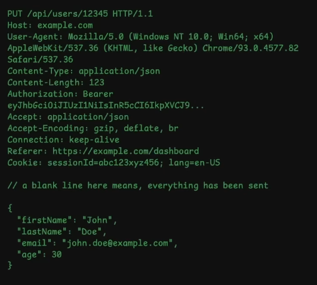
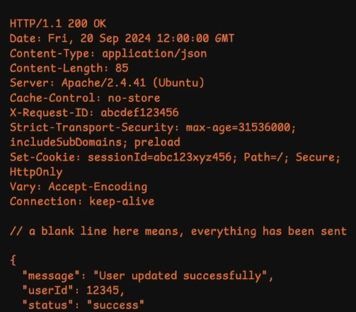

# Understanding HTTP
http is one of the protocols which is used to establish connection between a client and a server
1. It's a stateless protocol ( it doesn't have the memory about the past interaction)
	 -  Because it's stateless it's easy to scale as any request can be handled by different servers if one server goes down.
	 - We need to create some state management techniques to maintain the state between different sessions like - cookies, token, etc. to maintain continuity in interactions when needed. like - login state, user's info.
2. client-sever model ( https works on the sever client architecture. )
	-  where the client sends a request to the server and the server processes the request and sends a response for clients request.
	- It's uses TCP as underlying protocol which is more reliable the UDP for data transmission.
	- The latest version of http uses Udp for faster transmission of the data as UDP is faster then the TCP.
3. http headers: ( Request and Response )
	- Request Headers: This is generated by the client browser to make a request to the server 
	- Ex: 
	- Response Headers: This is generated by the server to serve the request of the client.
	- Ex: 
	- Request Headers contains information about 
		- User Agent
		- Authorization
		- Cookie
		- Accept
	- General Headers contains
		- Date
		- Cache control
		- Connection
	- Representation Headers contains
		- Content-Type
		- Content-Length
		- Content-Encoding
		- ETag
	- Security Headers contains
		- Strict-Transport-Security (HSTS)
		- Content-Security-Policy (CSP)
		- X-Frame-Options
		- X-Content-Type-Options
		- Set-Cookie
4. http methods: The http methods defines the intent of the request made to the server
	1. GET: It's used to fetch some kind of data from the server and it shouldn't modify any data on the server
	2. POST: It's used to create some kind of data on the server
	3. PUT: It's used to update data on the server which we have previously create on the server completely ( like replace a user completely with new data provided by the client. )
	4. PATCH: It's used to update some kind of data which we have previously created on the server (In user data patch can be used to update name of the user)
	5. DELETE: It's is used to delete data from the server.
	- These method can be idempotent or non-idempotent.
		- Idempotent: doesn't effect the result if we call the methods multiple times like - GET, PUT, DELETE these methods would genenrate the same result even after calling the multiple times.
		- Non-Idempotent: effects the original data on calling multiple time like - POST method would generate a new field each time it's called.
5. OPTIONS method: This method is used to update CORS policy generally browsers blocks responses from different domains by using this method we can specify which domains should not be blocked by the browser while getting a response from the server.
6. Preflighted Request: The browser genrerates a preflighted request it either one of them is true:
	- The method isn't GET, POST, or HEAD (eg- PUT, DELETE).
	- The request includes non-simple headers (like - Authorization, X-Custom-Header).
	- The request has Content-Type other than application/x-www-from-urlencoded, multipart/form-data, or text/plain.
